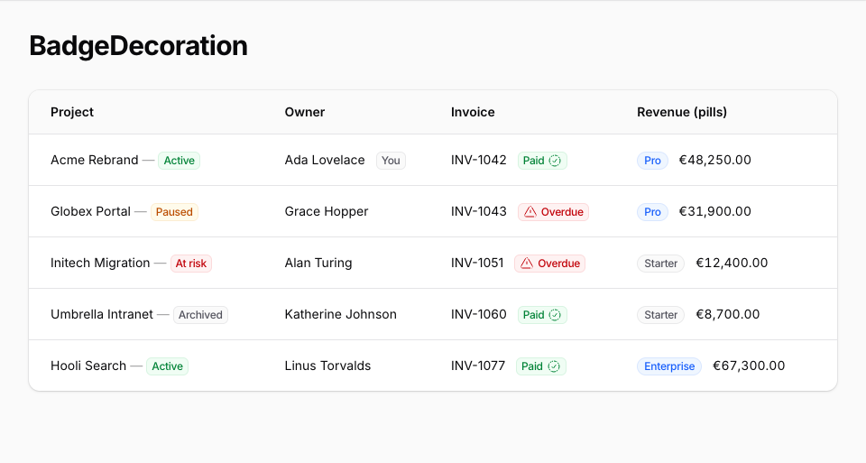
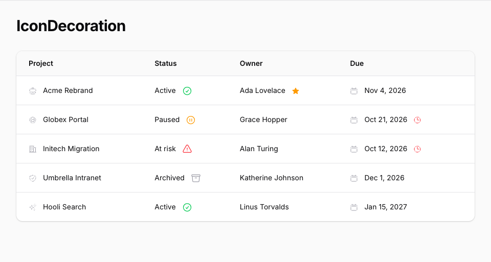
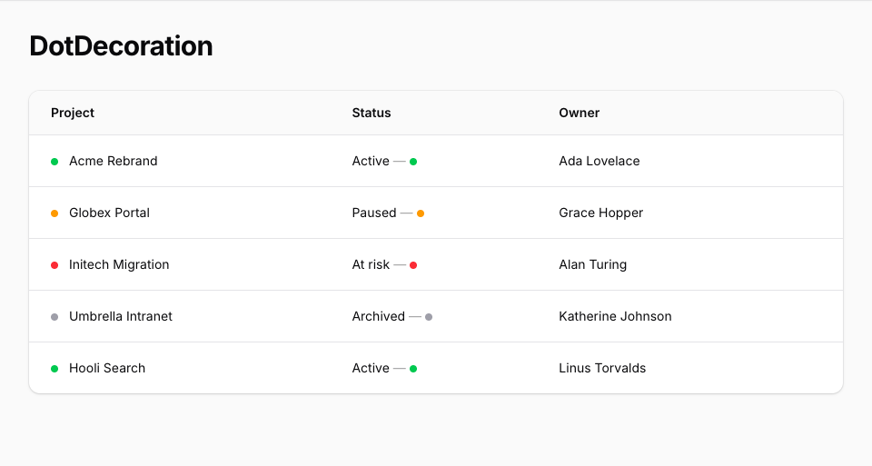
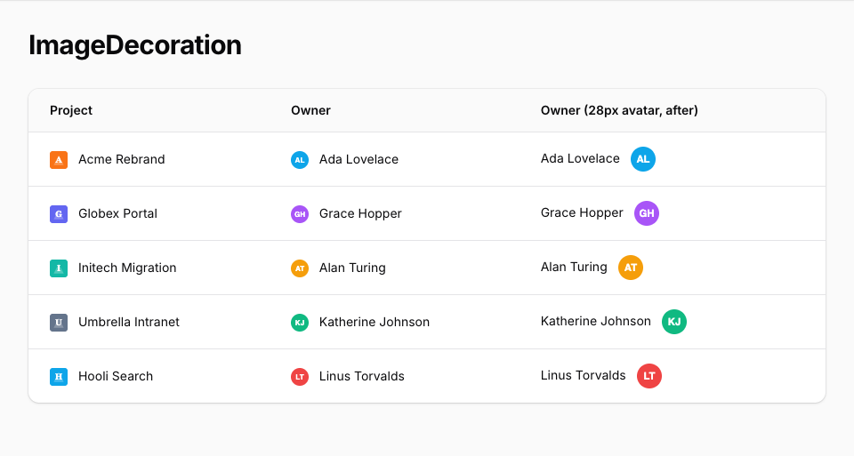
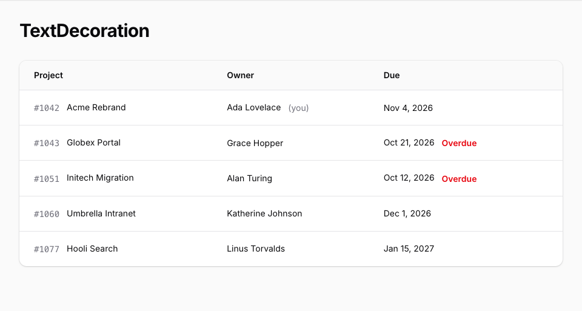
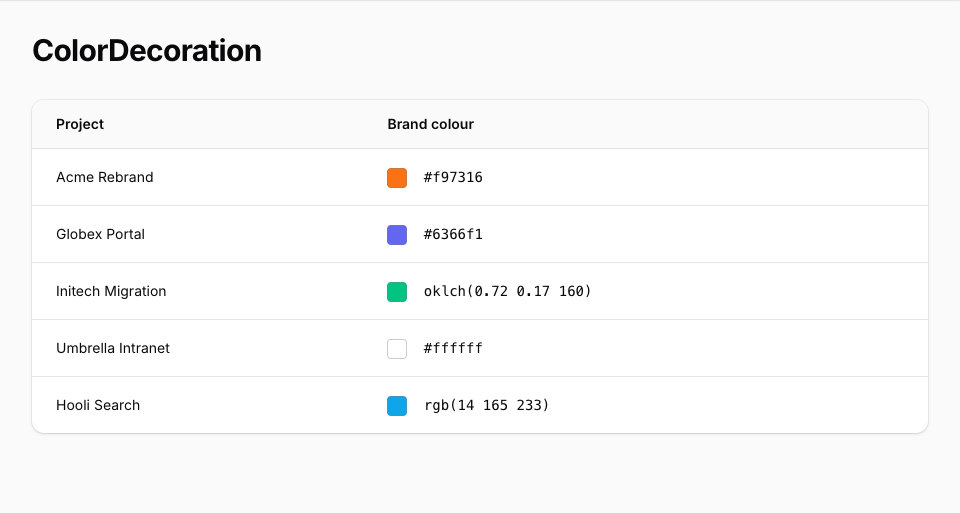
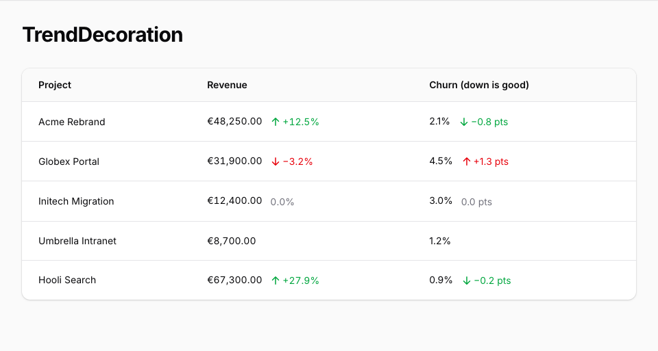
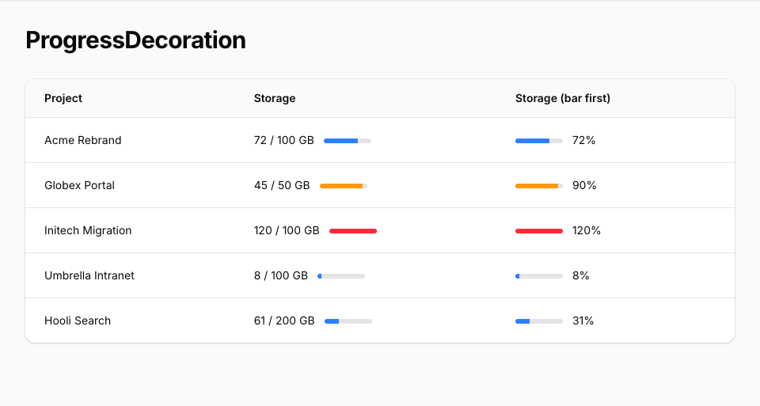

# Filament Decorated Column

[](https://packagist.org/packages/ornio/filament-decorated-column)
[](https://github.com/ornio-no/filament-decorated-column/actions?query=workflow%3Atests+branch%3Amain)
[](https://github.com/ornio-no/filament-decorated-column/actions?query=workflow%3Afix-code-style+branch%3Amain)
[](https://packagist.org/packages/ornio/filament-decorated-column)

`DecoratedColumn` and `DecoratedEntry` are Filament's `TextColumn` and `TextEntry` with a slot before and a slot after the text. The slots hold decorations of eight kinds, in any mix: [badges](#badges), [icons](#icons), [dots](#dots), [images](#images), [secondary text](#text), [colour samples](#colors), [trends](#trends), and [progress bars](#progress). Every decoration takes a tooltip and closures that see the row's record. The views use inline styles and Filament's own `fi-*` classes, so there is no theme to build and no `@source` line to add.

```php
use App\Models\Client;
use Filament\Support\Icons\Heroicon;
use Ornio\FilamentDecoratedColumn\BadgeDecoration;
use Ornio\FilamentDecoratedColumn\DecoratedColumn;
use Ornio\FilamentDecoratedColumn\IconDecoration;

DecoratedColumn::make('name')
    ->prefixDecorations([
        IconDecoration::make('type')->icon(Heroicon::OutlinedBriefcase)->label('Business'),
    ])
    ->suffixBadges([
        BadgeDecoration::make('vip')
            ->label('VIP')
            ->color('success')
            ->visible(fn (Client $record): bool => $record->is_vip),
    ]);
```

Each row shows the briefcase, an em dash, and the name. VIP rows add another em dash and a green badge.

## Installation

```bash
composer require ornio/filament-decorated-column
```

Requires PHP 8.2 or later and Filament 5.7 or later. Laravel discovers the service provider. There is no panel plugin to register, no config to publish, and no theme to build.

To change the markup, publish the views:

```bash
php artisan vendor:publish --tag="filament-decorated-column-views"
```

## Usage

### Table columns

`DecoratedColumn` extends `TextColumn`, so `description()`, `searchable()`, `sortable()`, `wrap()`, and the rest work unchanged. Add decorations with `prefixDecorations()` and `suffixDecorations()`, or their aliases `prefixBadges()` and `suffixBadges()`. All four take an array of decorations of any kind, such as a `DotDecoration` next to a `BadgeDecoration`, or a closure that returns one.

```php
use App\Models\Client;
use Filament\Tables\Table;
use Ornio\FilamentDecoratedColumn\BadgeDecoration;
use Ornio\FilamentDecoratedColumn\DecoratedColumn;

public static function configure(Table $table): Table
{
    return $table->columns([
        DecoratedColumn::make('name')
            ->description(fn (Client $record): ?string => $record->registration_number)
            ->suffixBadges([
                BadgeDecoration::make('type')
                    ->label(fn (Client $record): string => $record->type->getLabel())
                    ->color(fn (Client $record): string => $record->type->getColor()),
            ])
            ->searchable()
            ->sortable(),
    ]);
}
```

Here `type` casts to an enum that implements Filament's `HasLabel` and `HasColor` contracts.

A bare icon in the prefix slot, driven by an enum that implements `HasIcon`:

```php
use App\Models\Activity;
use Filament\Support\Enums\IconSize;
use Filament\Support\Icons\Heroicon;
use Ornio\FilamentDecoratedColumn\DecoratedColumn;
use Ornio\FilamentDecoratedColumn\IconDecoration;

DecoratedColumn::make('description')
    ->prefixDecorations([
        IconDecoration::make('type')
            ->icon(fn (Activity $record): Heroicon => $record->type->getIcon())
            ->size(IconSize::Large),
    ])
    ->wrap(),
```

### Infolist entries

`DecoratedEntry` extends `TextEntry` and takes the same methods.

```php
use App\Models\Client;
use Filament\Schemas\Schema;
use Ornio\FilamentDecoratedColumn\BadgeDecoration;
use Ornio\FilamentDecoratedColumn\DecoratedEntry;

public static function configure(Schema $schema): Schema
{
    return $schema->components([
        DecoratedEntry::make('name')
            ->suffixBadges([
                BadgeDecoration::make('type')
                    ->label(fn (Client $record): string => $record->type->getLabel())
                    ->color(fn (Client $record): string => $record->type->getColor()),
            ]),
    ]);
}
```

Both work in any table or infolist, inside a panel or in the standalone packages.

## Badges

`BadgeDecoration::make('name')` creates a badge. The name doubles as the default label: `BadgeDecoration::make('hot')` reads "Hot" and `BadgeDecoration::make('is_paid')` reads "Is paid".

<picture>
    <source media="(prefers-color-scheme: dark)" srcset="art/screenshots/badge-dark.png">
    
</picture>

| Method | What it sets | Default |
| --- | --- | --- |
| `label()` | The text. | Derived from the name. |
| `color()` | A Filament colour name such as `success` or `gray`, or a palette array. | `primary` |
| `size()` | `Size::ExtraSmall` to `Size::ExtraLarge`, or `xs` to `xl`. | `Size::Small` |
| `weight()` | A `FontWeight` case or its string value. | `FontWeight::Medium` |
| `fontFamily()` | `FontFamily::Sans`, `Serif`, or `Mono`, or the string. | Inherited. |
| `isPill()` | Full rounding (`border-radius: 9999px`) for this badge alone. `isPill(false)` opts out of the column's `asPills()`. `null` follows the column. | `null` |
| `icon()` | An icon, such as `Heroicon::OutlinedCheckCircle`. | None |
| `iconPosition()` | `IconPosition::Before` or `IconPosition::After`. | `IconPosition::Before` |
| `tooltip()` | Text shown on hover. | None |
| `visible()`, `hidden()` | Whether the badge renders. | Visible |

Every method accepts a closure. See [Closure parameters](#closure-parameters).

`weight()` and `fontFamily()` put Filament's `fi-font-*` class on the badge (`fi-font-bold`, `fi-font-mono`). Filament's stylesheet defines those classes for text items and links, not for badges, so they change a badge only where your theme styles `.fi-badge.fi-font-*`.

A hidden badge renders nothing. When every decoration in a slot is hidden, the slot's separator goes with it.

```php
use App\Models\TeamMember;
use Filament\Support\Enums\IconPosition;
use Filament\Support\Icons\Heroicon;

BadgeDecoration::make('you')
    ->color('gray')
    ->tooltip('You cannot change your own role.')
    ->visible(fn (TeamMember $record): bool => $record->user_id === auth()->id()),

BadgeDecoration::make('paid')
    ->color('success')
    ->icon(Heroicon::OutlinedCheckCircle)
    ->iconPosition(IconPosition::After),
```

## Icons

`IconDecoration::make('name')` renders an icon with no badge around it.

<picture>
    <source media="(prefers-color-scheme: dark)" srcset="art/screenshots/icon-dark.png">
    
</picture>

| Method | What it sets | Default |
| --- | --- | --- |
| `icon()` | The icon to draw. | None |
| `size()` | An `IconSize` case or its string value. | `IconSize::Small` |
| `color()` | A Filament colour name, or a palette array. Gray draws with `var(--gray-400)`; any other name uses shade 500, as a `TextColumn` icon does. | `gray` |
| `label()` | A name for screen readers. The icon gets `role="img"` and `aria-label`. | None |
| `tooltip()` | Text shown on hover. | None |
| `visible()`, `hidden()` | Whether the icon renders. | Visible |

The colour name goes into an inline style, so on an icon, dot, text, or progress bar a name holding anything but lowercase letters, digits, and hyphens draws gray instead. That keeps a name returned by a closure from injecting CSS.

Without `label()` the icon is decorative and carries `aria-hidden="true"`. That is right when the text beside it already says what the icon means. Give a label when the icon carries meaning on its own, and add `tooltip()` to show that meaning on hover too.

```php
IconDecoration::make('type')
    ->icon(Heroicon::OutlinedBriefcase)
    ->label('Business')
    ->tooltip('Business client'),
```

## Dots

`DotDecoration::make('name')` renders a small filled circle, half a line tall, in a palette colour. Use it for a status. It has no size setting.

<picture>
    <source media="(prefers-color-scheme: dark)" srcset="art/screenshots/dot-dark.png">
    
</picture>

| Method | What it sets | Default |
| --- | --- | --- |
| `color()` | A Filament colour name such as `success` or `danger`. Gray draws with `var(--gray-400)`; any other name uses shade 500, as an icon does. Palette arrays are not supported. | `gray` |
| `label()` | A name for screen readers. The dot gets `role="img"` and `aria-label`. | None |
| `tooltip()` | Text shown on hover. | None |
| `visible()`, `hidden()` | Whether the dot renders. | Visible |

Without `label()` the dot is decorative and carries `aria-hidden="true"`, as an unlabelled icon does. A screen reader can't announce a colour, so give a label when the dot shows a status that the text beside it doesn't.

```php
use App\Models\Client;
use Ornio\FilamentDecoratedColumn\DotDecoration;

DecoratedColumn::make('name')
    ->prefixDecorations([
        DotDecoration::make('status')
            ->color(fn (Client $record): string => $record->is_active ? 'success' : 'gray')
            ->label(fn (Client $record): string => $record->is_active ? 'Active' : 'Inactive')
            ->tooltip(fn (string $state): string => $state),
    ]),
```

## Images

`ImageDecoration::make('name')` renders a small picture from a URL, such as an avatar, a logo, or a flag. The picture fills its box without being stretched (`object-fit: cover`) and loads lazily.

<picture>
    <source media="(prefers-color-scheme: dark)" srcset="art/screenshots/image-dark.png">
    
</picture>

| Method | What it sets | Default |
| --- | --- | --- |
| `image()` | The picture's URL. | None |
| `size()` | Width and height: a CSS length such as `'2rem'`, `'12px'`, or `'50%'`, or an integer number of pixels. Anything else, such as `calc()`, a unitless number, or a negative length, falls back to the default. | `'1.25rem'`, one line of text |
| `circular()` | Full rounding, for avatars. Calling it with no argument turns it on. | Square |
| `label()` | The `alt` text. | None |
| `tooltip()` | Text shown on hover. | None |
| `visible()`, `hidden()` | Whether the image renders. | Visible |

Without `label()` the image is decorative and gets `alt=""`, so screen readers skip it. That suits an avatar beside the person's name.

When `image()` gives null or an empty string, the image renders nothing, as if it were hidden. If nothing else in the slot renders, the separator goes too, so a row without a picture shows only its text.

```php
use App\Models\User;
use Ornio\FilamentDecoratedColumn\ImageDecoration;

DecoratedColumn::make('name')
    ->prefixDecorations([
        ImageDecoration::make('avatar')
            ->image(fn (User $record): ?string => $record->avatar_url)
            ->circular(),
    ]),
```

## Text

`TextDecoration::make('name')` shows its label as secondary text, such as "(you)" after a name. As on a badge, the label is derived from the name when unset, and it is escaped. The text has no size setting: it takes the size of the text around it.

<picture>
    <source media="(prefers-color-scheme: dark)" srcset="art/screenshots/text-dark.png">
    
</picture>

| Method | What it sets | Default |
| --- | --- | --- |
| `label()` | The text. | Derived from the name. |
| `color()` | A Filament colour name. Gray draws with `var(--gray-500)`; any other name uses shade 600 in light mode and shade 400 in dark mode, through CSS `light-dark()`. Palette arrays are not supported. | `gray` |
| `weight()` | A `FontWeight` case or its string value. | Inherited. |
| `fontFamily()` | `FontFamily::Sans`, `Serif`, or `Mono`, or the string. | Inherited. |
| `tooltip()` | Text shown on hover. | None |
| `visible()`, `hidden()` | Whether the text renders. | Visible |

`light-dark()` follows the `color-scheme: dark` that a Filament panel sets in dark mode. Outside a panel, coloured text keeps its light-mode shade unless your page sets `color-scheme` itself.

`weight()` and `fontFamily()` set the text's `font-weight` and `font-family` inline. A weight is set as its number, such as `700` for `FontWeight::Bold`. A family uses the font your panel is configured with (the `--font-family`, `--serif-font-family`, and `--mono-font-family` variables that Filament sets), followed by generic families for pages outside a panel. A string that is not a `FontWeight` or `FontFamily` value is added as a class instead, for your theme to style.

```php
use App\Models\Invoice;
use App\Models\TeamMember;
use Ornio\FilamentDecoratedColumn\TextDecoration;

TextDecoration::make('you')
    ->label('(you)')
    ->visible(fn (TeamMember $record): bool => $record->user_id === auth()->id()),

TextDecoration::make('overdue')
    ->color('danger')
    ->visible(fn (Invoice $record): bool => $record->is_overdue),
```

## Colors

`ColorDecoration::make('name')` shows a raw colour from your data, such as a product's hex code, as a sample of itself. The sample is a 1.25rem square with slightly rounded corners and a thin translucent gray border, so white and black samples stay visible.

<picture>
    <source media="(prefers-color-scheme: dark)" srcset="art/screenshots/color-dark.png">
    
</picture>

| Method | What it sets | Default |
| --- | --- | --- |
| `value()` | The raw colour, in one of the formats below. | None |
| `label()` | A name for screen readers. The sample gets `role="img"` and `aria-label`. | None |
| `tooltip()` | Text shown on hover. | None |
| `visible()`, `hidden()` | Whether the sample renders. | Visible |

The raw colour goes into an inline style, where HTML escaping doesn't stop CSS injection, so only these formats are accepted, in any letter case:

- `#rgb`, `#rgba`, `#rrggbb`, and `#rrggbbaa`.
- `rgb()`, `rgba()`, `hsl()`, `hsla()`, and `oklch()` holding only numbers, each with an optional `%`, `deg`, `grad`, `rad`, or `turn` unit. Commas, slashes, and plain spaces may separate them. A tab or a line break inside the parentheses gets the value rejected.

Any other value, such as a colour name like `red`, a `var()`, or null, renders nothing, as if it were hidden. The inherited `color()` is ignored, because the sample always shows the raw colour.

Without `label()` the sample is decorative and hidden from screen readers, which suits a sample next to the colour code it shows.

```php
use App\Models\Product;
use Ornio\FilamentDecoratedColumn\ColorDecoration;

DecoratedColumn::make('color')
    ->prefixDecorations([
        ColorDecoration::make('sample')
            ->value(fn (Product $record): ?string => $record->color),
    ]),
```

## Trends

`TrendDecoration::make('name')` shows a change as an arrow and a signed number, coloured by direction:

- A rise shows an up arrow, a plus sign, and the success colour: `+12.5%`.
- A fall shows a down arrow, a minus sign (`−`, not a hyphen), and the danger colour: `−3.2%`.
- Zero shows in gray, with no arrow and no sign: `0.0%`.

The direction is decided after rounding, so a change of `0.04` shows as a gray `0.0%`, never as a green `+0.0%`.

<picture>
    <source media="(prefers-color-scheme: dark)" srcset="art/screenshots/trend-dark.png">
    
</picture>

| Method | What it sets | Default |
| --- | --- | --- |
| `value()` | The change, as an int or a float. A closure may also return a numeric string, which is what a `decimal` column or cast gives; any other string renders nothing. | None |
| `decimals()` | How many decimal places the change is rounded to. | `1` |
| `unit()` | Text appended exactly as given, with no space added. `null` removes it. | `'%'` |
| `inverse()` | Swaps the success and danger colours, for a metric where down is good, such as churn or cost. The arrow and sign still follow the change. Calling it with no argument turns it on. | Off |
| `tooltip()` | Text shown on hover. | None |
| `visible()`, `hidden()` | Whether the trend renders. | Visible |

The colour follows the direction, so the inherited `color()` is ignored. It uses the shades a text decoration uses. The number has a plain decimal point, no thousands separator, and no locale formatting. A null change, or one that is not a finite number (`NAN` or infinity), renders nothing, as if it were hidden. Screen readers skip the arrow and read the signed number.

```php
use App\Models\Account;
use Ornio\FilamentDecoratedColumn\TrendDecoration;

DecoratedColumn::make('revenue')
    ->suffixDecorations([
        TrendDecoration::make('revenue_change')
            ->value(fn (Account $record): ?float => $record->revenue_change),
    ]),

DecoratedColumn::make('churn_rate')
    ->suffixDecorations([
        TrendDecoration::make('churn_change')
            ->value(fn (Account $record): ?float => $record->churn_change)
            ->decimals(2)
            ->unit(' pp')
            ->inverse(),
    ]),
```

## Progress

`ProgressDecoration::make('name')` shows a thin bar filled to show how far a value has come toward its maximum. The track is 3.75rem wide and 0.375rem tall, with rounded ends.

<picture>
    <source media="(prefers-color-scheme: dark)" srcset="art/screenshots/progress-dark.png">
    
</picture>

| Method | What it sets | Default |
| --- | --- | --- |
| `value()` | The value, as an int or a float. | None |
| `max()` | The maximum. | `100` |
| `color()` | A Filament colour name for the fill. Gray draws with `var(--gray-400)`; any other name uses shade 500. Palette arrays are not supported. | `primary` |
| `label()` | A name for screen readers. The bar gets `role="progressbar"`, `aria-valuenow`, `aria-valuemin`, `aria-valuemax`, and `aria-label`. | None |
| `tooltip()` | Text shown on hover. | None |
| `visible()`, `hidden()` | Whether the bar renders. | Visible |

The value is clamped between 0 and the maximum, so the fill never overflows the track, and `aria-valuenow` reports the clamped value. A maximum of zero or less shows an empty bar, and `aria-valuemax` reports it as 0. A null value renders nothing, as if it were hidden.

Without `label()` the bar is decorative and hidden from screen readers, which suits a bar beside the figure it draws.

```php
use App\Models\Account;
use Ornio\FilamentDecoratedColumn\ProgressDecoration;

DecoratedColumn::make('seats_used')
    ->suffixDecorations([
        ProgressDecoration::make('seats')
            ->value(fn (Account $record): int => $record->seats_used)
            ->max(fn (Account $record): int => $record->seat_limit)
            ->color(fn (Account $record): string => $record->seats_used >= $record->seat_limit ? 'danger' : 'primary'),
    ]),
```

## Pills

`asPills()` on the column or entry rounds every badge in both slots. It accepts a closure. A single badge overrides it with `isPill()` or `isPill(false)`.

```php
DecoratedColumn::make('name')
    ->asPills()
    ->suffixBadges([
        BadgeDecoration::make('new'),
        BadgeDecoration::make('draft')->isPill(false),
    ]);
```

## Separator

`separator()` sets the mark between the text and a non-empty slot. When you never call it, the mark is an em dash (`&mdash;`) at reduced opacity. Calling it with no argument sets a comma, because the method's own default is `','`. Pass a string or a closure. A blank string removes the mark and widens the gap between slot and text from 0.25rem to 0.5rem.

```php
DecoratedColumn::make('name')->separator('')->suffixBadges([/* ... */]);
DecoratedColumn::make('name')->separator('&middot;')->suffixBadges([/* ... */]);
```

The separator is output as raw HTML, so entities work and user input must never go there.

Text set with `prefix()` or `suffix()` still renders, between the separator and the column text.

On `TextColumn` and `TextEntry`, `separator()` means something else: it splits a string state into a list on that character. `DecoratedColumn` and `DecoratedEntry` replace that method, and the inherited `getSeparator()` stays null, so the state is never split. A value containing the separator character stays one value. If you need a list, give the column an array state.

## Closure parameters

Every closure on a decoration can ask for these parameters by name:

- `$record`: the row's Eloquent model, or null when the column has none.
- `$state`: the decoration's own resolved label, not the column's state.
- `$livewire`: the Livewire component that owns the table or infolist.

Parameters match by name, so call them exactly that. The type hint can be your model class: `fn (Client $record)`. Other type-hinted parameters resolve from the container, as in any Filament closure.

That includes the data setters: `image()` on an image, `value()` on a color, trend, or progress, and `max()` on a progress. They get the same three parameters as every other setter. None of them receives the column's state, so read the data from `$record`, as the examples above do.

`$state` is for `color()`, `icon()`, `tooltip()`, `visible()`, `value()`, and the like. Don't request it inside `label()`: the label is what `$state` resolves to, so the closure would call itself. Inside `weight()` and `fontFamily()`, Filament's own traits inject `$state` as null.

```php
use App\Models\Invoice;

BadgeDecoration::make('status')
    ->label(fn (Invoice $record): string => $record->status->getLabel())
    ->color(fn (string $state): string => $state === 'Overdue' ? 'danger' : 'gray'),
```

## Testing

```bash
composer test
```

## Changelog

Please see [CHANGELOG](CHANGELOG.md) for more information on what has changed recently.

## Contributing

Please see [CONTRIBUTING](.github/CONTRIBUTING.md) for details.

## Security Vulnerabilities

Please review [our security policy](.github/SECURITY.md) on how to report security vulnerabilities.

## Credits

- [Flamur Mavraj](https://github.com/oxodesign)
- [All Contributors](../../contributors)

## License

The MIT License (MIT). Please see [License File](LICENSE.md) for more information.
